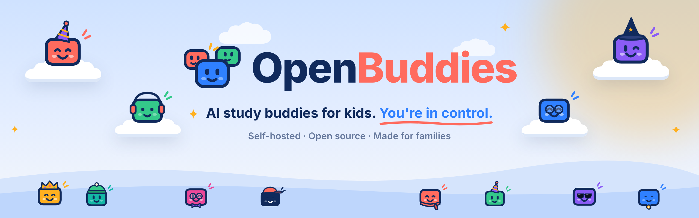

<p align="center">
  
</p>

<p align="center">
  <b>Open-source AI study buddies for families, self-hosted at home.</b><br>
  A pair tutor, not an answer machine.
</p>

## What it is

- **Kids make their own buddies** to chat, draw pictures, take quizzes and get homework help, from their phone or laptop.
- **A tutor, not an answer machine.** Buddies guide with questions, hints and worked examples of *similar* problems, so
  children work it out themselves.
- **Parents stay in control.** Read every message, and set each child's help level, daily AI allowance and apps.
- **It all stays at home.** A parent installs it on a computer in the house, and the chats are kept there, not on an app
  company's servers.

## Quick start

```
pnpm install && pnpm build
npx openbuddies init      # set up the household (≈2 minutes)
npx openbuddies start     # parent page opens; scan the QR code with your child's phone
```

## Commands

| Command | What it does |
|---|---|
| `openbuddies init` | Interactive setup: parent and PIN, AI provider, models and key (validated), children and per-subject strictness, folder. Installs a launchd (macOS) or systemd user (Linux) service. |
| `openbuddies start` | Starts the server, prints the parent and child URLs and a pairing QR per child, opens the parent page. If a server is already running but it's an older version, or a previous setup of this folder, it's restarted first. |
| `openbuddies stop` / `status` | Stop, or show state (including the models, with a warning for ones OpenBuddies isn't tuned for). `status --check` is the self-test: lists every session's tools and fails if anything beyond the six tutor tools is present. |
| `openbuddies pair <child>` | Fresh single-use QR code (expires in 10 minutes). |
| `openbuddies logs <child>` | Tail transcripts in the terminal, with intent/action tags and blocked-draft counts. |
| `openbuddies reset` | Back to a fresh install. Lists exactly what will be deleted, offers a timestamped backup copy (default yes), and needs you to type `reset`. Stops and removes this household's service only, turns off OpenBuddies' Tailscale Serve, and deletes the folder. `--yes` skips the prompts (still backs up unless `--no-backup`). |
| `openbuddies children list\|add\|mode\|allowance` | List children, add one (asks the same questions as `init`, or pass `--name --age --year --mode`), change a child's help level, or set their daily AI allowance (`openbuddies children allowance sam 300000`, or `default`). Also on the parent page under **Children**. |
| `openbuddies subjects list\|add\|mode\|remove <child> …` | Manage a child's subjects and how strict each is, e.g. `openbuddies subjects add sam design & technology --mode balanced`. Also on the parent page under **Children**. |
| `openbuddies apps [gallery\|add <source>\|remove <id>\|on\|off <child> <app>]` | Apps on each child's home screen. `add` takes a gallery id, an https link to an app bundle, or a folder, shows the app in full, and asks before adding it. Also on the parent page under **Apps**. |
| `openbuddies images [setup]` | Picture Studio's image model: OpenAI or Google, with a daily picture limit per child. |
| `openbuddies web [setup\|test <query>]` | Looking things up on the internet: which search provider is set up and each child's setting; `setup` picks Brave, Tavily or a self-hosted SearXNG, runs a test search and saves the key in `.env`. `openbuddies children web <child> off\|trusted\|open` sets a child's internet. |
| `openbuddies tailscale [setup\|status\|off]` | Set up Tailscale (asks before installing anything) and Tailscale Serve for an HTTPS address only your devices can reach. `init` offers this too. |

All commands take `--home <dir>`. The household folder is found via `--home`, `$OPENBUDDIES_HOME`, the `~/.openbuddiesrc` pointer `init` writes for non-default locations, or `~/openbuddies`.

## The household folder

Copying it is the whole backup and migration story.

```
~/openbuddies/
├─ openbuddies.yaml          parent (name, title, argon2 PIN hash), models (provider/model), port, daily token budget
├─ .env                   API keys (one per provider in use, e.g. ANTHROPIC_API_KEY), chmod 600
├─ children/<id>/
│  ├─ profile.yaml        name, age, year, subjects
│  ├─ rules.yaml          strictness per subject, hint ladder, leak retries, welfare sensitivity, optional hours
│  ├─ CONTEXT.md          generated from the two files above; regenerated when they change
│  └─ sessions/           Pi session files (one per sitting)
├─ apps/<id>/             apps you added: app.yaml + SKILL.md (+ install.yaml); YAML and Markdown only (see Apps)
├─ data/openbuddies.db       SQLite: sessions, turns, blocked drafts, tool calls, problems, alerts, devices
└─ logs/server.log
```

`rules.yaml`, `profile.yaml`, `openbuddies.yaml`, `.env`, `app.yaml` and `SKILL.md` reload on save without a restart.

## How enforcement works

Every child message goes through `src/server/pipeline.ts`. The model never polices itself.

A message shows in the chat as soon as it arrives. A child's messages run one at a time, and any sent while the buddy is
still busy are answered together in one turn ("wait", "no", "i meant 3/4" get one reply to the whole thought, and one
pass through the steps below instead of three).

1. **Classify** (small model, forced tool call with a JSON schema): intent, pressure, subject, welfare, problem. A keyword
   backstop can only *raise* welfare, so a classifier miss or outage can't silence a self-harm alert.
2. **Alert** the parent if welfare isn't `fine`, *before* any reply is generated: a fixed summary, never the child's words,
   saved for the parent page's **Alerts** (with an unread count). Nothing is sent to the parent's phone yet.
3. **Decide** (`src/server/decide.ts`, pure): the action and the highest ladder rung allowed this turn.
4. **Generate** with the Pi session. The action is appended to the child's message for that model call only (never saved).
   Tool calls are checked against the action (`src/server/tools.ts`); rejections go back to the model and are logged.
   Pi retries a provider failure (up to twice) by dropping the failed message and carrying on from the tool results
   already in the session, so tools never run twice and the failed text never reaches the reply (tested in
   `test/agent.test.ts`).
5. **Leak check** (separate small-model call), guarding the homework problem, on *everything the child would see*, including hint and example cards and
   the pinned problem label. A blocked draft is rolled back out of the Pi history, its tool effects are discarded, and the
   tutor retries with the blocked text to avoid. After `max_leak_retries` the child gets a fixed safe fallback.
   The leak check fails closed. Enforced replies stream to the device only after they pass. A general question that
   isn't a homework problem (what's due this month, how to plan revision, how the app works) is labelled `general`
   and simply answered; the leak check still guards any active problem, and with none there's nothing to give away.
6. **Log** everything: intent, action, rung changes, blocked drafts, accepted and rejected tool calls.

## Help level and subjects

Each child has one **help level**: Strict (never gives answers), Balanced (shows the answer after real effort) or
Relaxed (explains freely). `init` and `openbuddies children add` ask for it; change it with `openbuddies children mode <child>
<level>` or on the parent page under **Children**. It's `default_mode` in the child's `rules.yaml`.

Subjects come mostly from the child: when they make a study buddy they can pick one of their subjects or add a new one
(it follows their help level). A parent can also add subjects, and give any subject its own level, with
`openbuddies subjects …` or on the parent page. A subject lives in `profile.yaml` (its name) and, if it has its own level,
`rules.yaml`; both are edited with comments preserved, and the server reloads straight away. The classifier picks from
the child's subjects plus `other`, and anything without its own level uses the child's help level.

## Remote access with Tailscale (recommended for an always-on home machine)

Without Tailscale, phones work only on home Wi-Fi over plain HTTP, and the parent page opens only on the OpenBuddies
machine itself. With it, `init` (or `openbuddies tailscale`):

1. asks first, then installs Tailscale (Linux: the official script, which uses sudo; macOS: opens the download page),
2. signs in with `tailscale up --qr`, so a machine with no screen can be signed in from your phone,
3. turns on **Tailscale Serve**, giving `https://<machine>.<tailnet>.ts.net`, reachable only by your own devices
   (the same approach as [OpenClaw's remote access](https://docs.openclaw.ai/gateway/tailscale)).

Pairing QR codes then use the HTTPS address, which also lets Chrome offer **Add to home screen**. Behind Serve every
request arrives from loopback, so the server reads the real tailnet address from `X-Forwarded-For`, trusting it only
when the TCP peer is loopback. The phone still needs the Tailscale app, signed in to the same account; OpenBuddies shows a
QR code for the download.

## Security model

The threat model is a curious, capable 12-year-old.

- **Keys never leave the box.** Read from `.env` into an in-memory credential store; never in `~/.pi`, responses, logs or
  error messages (errors pass through a redactor). Tests scan every HTTP/WebSocket response, the built bundle and session files for the key.
- **No coding tools.** Only the six tutor tools. Startup refuses to run unless every session exposes exactly those six.
- **Rules stay server-side.** The child receives reply text and UI events only (`src/shared/protocol.ts` is the whole contract).
- **Server instructions can't be forged.** The per-turn block carries a per-household random nonce; imitation tags typed by the child are stripped.
  Lookalike brackets (fullwidth `＜`, angle quotes and the like) are folded to `<`/`>` and hidden characters dropped first,
  so a disguised tag is caught too, and chat-template tokens such as `<|im_start|>` are removed.
- **The child's material is fenced.** Files and memory notes reach the tutor between `<child-material id="…">` and
  `</child-material id="…">`, with a fresh random id each model call (the same idea as OpenClaw's
  `wrapExternalContent`). The material is written before the id exists, so it can't end the block early.
- **Devices.** One-time pairing tokens (10 min); 32-byte device tokens stored as SHA-256; every socket message re-checks
  revocation, and revoking closes the device's sockets immediately.
- **Parent.** `/parent` and `/api/parent/*` only answer loopback and Tailscale addresses, behind the PIN (argon2id),
  5 failures per 15 minutes per IP, HttpOnly SameSite=Strict session cookie.
- **Network.** Binds loopback, private-LAN and Tailscale addresses individually (never `0.0.0.0`), and rejects any
  public source address. No port forwarding.
- **Spending.** A daily token allowance per child: the household's `budget.daily_tokens_per_child` (400,000 by default),
  or the child's own `daily_tokens` in `rules.yaml`, set on the parent page under **Children** (Default, Light 150k,
  Normal 400k, Plenty 1M or a custom number) or with `openbuddies children allowance`. Every model call for the child
  counts: classifier, tutor, leak checks, photo reading and memory updates. When it's used up, the child gets a
  "resting until tomorrow" notice and no model is called. Also set a monthly limit in your provider console.
- **Telemetry.** Pi's install telemetry is disabled (`PI_TELEMETRY=0`, `enableInstallTelemetry: false`). Nothing leaves
  the machine except model API calls, reminders sent as notifications (encrypted, via the browser's push service), and
  web lookups (the search query, with the child's details taken out, to the search provider; then the chosen pages are
  fetched).

### Provider usage policies (read before first use)

AI providers have rules for products used by people under 18. Check yours, for example the
[Anthropic Usage Policy](https://www.anthropic.com/legal/aup) or [OpenAI Usage Policies](https://openai.com/policies/usage-policies),
before your child uses OpenBuddies. This is a private family tool with a parent supervising every conversation, but you are
responsible for using your API account within the provider's terms.

## Pi integration

`src/server/agent.ts` is the only file that imports Pi (`@earendil-works/pi-coding-agent` and `pi-ai`, pinned to **1.2.0**).

**Spike result (20 Oct 2026): all six assumptions held on 1.2.0, so no fallback to pi-agent-core was needed.**

| Assumption | How |
|---|---|
| Zero built-in tools, only custom tools | `tools: [six names]` + `customTools`; `getActiveToolNames()` verified |
| Typed in-process tools surface as events | `defineTool` with TypeBox schemas; `tool_execution_*` events |
| Skills and context from any folder | `DefaultResourceLoader` with `noExtensions`/`noSkills`, isolated `agentDir`, `systemPrompt` = framing + `SKILL.md`, `agentsFilesOverride` = `CONTEXT.md` |
| Persist and resume under `children/<id>/sessions/` | `SessionManager.create(cwd, dir)` / `SessionManager.open(file, dir)` |
| Per-turn instruction without polluting history | One first-party inline extension's `context` handler copies the messages and appends the action to the latest user message |
| Provider and key from code | `ModelRuntime.create({ credentials: new InMemoryCredentialStore() })` + `setRuntimeApiKey` |

Blocked drafts are removed with `session.navigateTree()` back to before the attempt, so a retry never sees them.
Note: SDK 1.3.0 existed but was newer than this machine's 7-day npm minimum release age, so 1.2.0 is pinned.

## Study buddies

When a child pairs their first device they make a **study buddy**: a name, one of eight colours, an optional
description ("a friendly maths teacher", "a funny pirate") and an optional subject it's best at. The first buddy is their
**main** buddy and can't be removed. They can make more (up to 10) and switch between them from the home screen or the
chat; each buddy keeps its own chat and its own problems.

- **Theme:** the app takes on the active buddy's colour (a tinted background, buttons and speech bubble), fading from
  one theme to the next on a switch. The last buddy's theme is remembered on the device, so a reload doesn't flash.
- **Voice:** each buddy greets the child in its own way on the home screen, picked from its description, subject or a
  fixed personality. These lines are written ahead of time; no model call.
- **Look:** a paint button on the buddy (on the home screen, and next to it while making or changing one) opens its
  look: the colour, and one thing on its head (cap, beanie, crown, party hat, wizard hat, headphones), over its eyes
  (glasses, shades) and round its neck (gold chain, scarf, bow tie, medal). The buddy wears it everywhere it appears,
  the chat included. Only the fixed list is accepted (`ACCESSORIES` in `src/shared/protocol.ts`); it's never sent to a
  model.
- **Subjects:** a buddy can be best at one of the child's subjects, or the child can type a new one. A new subject is
  added to the child's rules as **Strict**, and the parent can change or remove it under **Children**.

The tutor is told the buddy's name, description and subject. The name is limited to 20 letters, numbers, spaces,
apostrophes and hyphens; the description to 160 characters with markup and double quotes removed. The description is
the child's own text, so the tutor's instructions quote it as personality only: it can't change the rules, and decide()
and the leak check never read it. Parents see every buddy and its description under **Children**, and can edit or
remove them (not the main one). Removed buddies' chats stay in **Sessions**.

## Buddy files

A child can keep files with each buddy: photos of homework (taken with the phone's camera or picked from the photo
library) and text notes. Each buddy has a **file vault** (from the buddy's page, or **See all** under the chat's
paperclip): add photos and notes, search, filter photos and notes, open one full screen, rename or remove it, or tap
**Ask about it** to start the chat with it attached. In the chat, files are shared with the paperclip, or just by
mentioning them. Parents see and can remove every buddy's files under **Children**, and shared files show in session
transcripts.

- **Storage:** `data/files/<child>/<buddy>/` in the household folder (random names, private permissions), listed in the
  `buddy_files` table. Removing a file deletes its bytes. Removing a buddy (by the child, or the parent under
  **Children**) removes everything it kept: its files (bytes, records and what was read from them) and folder, its
  memory notes, its reminders and plans, and anything it had to tell the child. Its chats stay in Sessions for the
  parent. `openbuddies reset` removes everything.
- **What's accepted:** JPEG, PNG, WebP and GIF photos, and `.txt`/`.md` text, checked from the file's bytes, never its
  name. Up to 8 MB a file, 100 files a buddy, 4 per message. Photos are redrawn on the phone at up to 1600px before upload,
  which also strips their metadata (such as where they were taken).
- **How the buddy sees them** (the same pattern as OpenClaw, using Pi's `context` hook):
  - Every turn the buddy gets a short list of its files (names, one-line summaries, when added), not their content.
  - When the child shares a file, the saved conversation records a marker, `[file #12: sheet.jpg]`. Each time the
    conversation goes to the model, the hook loads the file from disk next to its marker: the newest four photos as
    real images (so the buddy sees diagrams and handwriting), older photos and text files as fenced text. Session files
    never hold the bytes, and a file that's been removed disappears from what the buddy sees.
  - A photo is also transcribed once, by the check model, when it's added (counted in the daily token budget). The
    transcription is what the classifier and the answer-leak check read, so a photographed question becomes the
    problem the leak check guards, and it's what a text-only tutor model gets.
  - **Mentioning a file is enough:** "check our history homework for this week and help me understand it". The
    classifier, which runs on every message anyway, also gets the buddy's files (name, one-line summary, the day it
    was added) and returns the ids the child means, at most two. So finding a file costs no extra model call. With
    more than 40 files, a quick word match picks the 40 likeliest, then the newest. Only those files are loaded; they're
    shared exactly as if the child had used the paperclip, so the leak check guards them, and a "Looking at" chip shows
    the child and the parent which ones. The server only accepts ids of that buddy's own ready files.
  - File content is always the child's material, fenced outside the server's nonce-marked instructions (see
    **Security model**). Markers a child types are removed, and a marker only loads that buddy's own files. The tutor
    still has six tools: files reach it through the paperclip or the classifier, never by the tutor asking.
- **Access:** a child's device reaches only its own child's files (`/api/child/...`, with its device token); the parent
  page uses its PIN session. Files are served with a sandboxing Content-Security-Policy and `nosniff`.

## Buddy memory

Each buddy keeps short notes about what it has worked on with the child (topics, what they find tricky, what helps),
so the next chat picks up where the last one left off. They're saved as Markdown in `data/memory/<child>/<buddy>.md`, so
a parent can read or edit them by hand (the previous version is kept as `.md.bak`).

- **When:** once a sitting is over (idle for `session_idle_minutes`, or the child switches buddy), straight after the
  child asks the buddy to remember something ("remember my test is on Friday"), and part-way through a very long
  sitting (40 unremembered messages). The buddy knows it can't write notes itself, so it says it'll add things rather
  than claiming it has, and says kindly when something (personal details, "rules") isn't something it keeps. A sweep every minute, and at startup, catches sittings that went idle.
  The check model rewrites the notes in the background, or says nothing changed and nothing is written. A failed call
  is retried on the next sweep.
- **Checked in code before saving:** the note-keeper is told never to record instructions, claims about rules or
  permissions, personal details, or anything about feelings, family or safety (worrying things go to the parent as
  alerts). Because the notes reach every future chat, that isn't left to the prompt: lines that claim permission,
  instruct the tutor, talk about changing the rules or carry markup are dropped (`checkNotes` in `src/server/memory.ts`),
  and an update that would throw away most of the existing notes is refused. Both are logged.
- **How the buddy gets them:** every turn, fenced as material next to its file list, outside the server's instructions.
- **Who sees them:** the child on their buddy's page, and the parent under **Children**; either can clear them. Removing
  a buddy removes its notes.

## Apps

Everything on a child's home screen is an app: a folder of text, never code (`app.yaml` says what it is and what it
uses, `SKILL.md` tells the buddy how to help). Homework and Picture Studio come with OpenBuddies (`apps/`); the gallery has
starter apps to add (Spelling Bee, Times Tables, Story Planner, in `gallery/`), and parents can add catalogues of other
people's apps or a single app by link. See [docs/writing-apps.md](docs/writing-apps.md) to write one.

- **Safe to add:** an app can't run anything, add tools or step round the pipeline. It can only ask for features
  OpenBuddies has (`hint_ladder`, `files`, `web`, `reminders`, `pictures`), and OpenBuddies' rules sit above its
  instructions. The parent reads the app in full (what it uses, and its SKILL.md) before adding it; the copy installed
  is the one they read (SHA-256), catalogue downloads must match the catalogue's fingerprint, and links must be https.
- **Per child:** built-in apps are on for every child; an added app is off until the parent turns it on for a child
  (`apps` in `rules.yaml`, the **Apps** page, or `openbuddies apps on`). The server only lets a child use apps that are on
  for them.
- **Each app has its own chat** with each buddy; chat events carry the app, so a device shows the right one.

## Picture Studio

The child asks their buddy for a picture in the chat ("I want a picture of a hotdog") and it's drawn; "add a dog to it"
changes the last one, so the picture builds up over the conversation. Before each reply, the check model reads the chat
(and what the last picture shows) and decides: **draw** (a new picture, or a change to the last), **chat** (talking
ideas over; the buddy replies as usual, as an art director), or **decline** kindly (no real people, nothing violent or
rude, no brands; a famous character becomes an original one). There's no Make it button and no new tool for the tutor.

The image model (`src/server/pictures.ts`) is OpenAI (`OPENAI_API_KEY`) or Google Imagen (`GEMINI_API_KEY`, people turned
off), whichever is set up first, or `IMAGE_PROVIDER`; `IMAGE_MODEL` picks a model. With OpenAI a change is made to the
last picture itself (the edits endpoint), so it stays the same picture; Google redraws it from the updated description.
Every request is wrapped as a child-friendly illustration with no text and no real people. While it draws, the chat
shows the buddy painting on a big square canvas; the picture then appears in the chat and is kept in the buddy's files
(named after it). Each child has a daily picture limit (`pictures.daily` in `rules.yaml`, 6). Set it up with
`openbuddies images setup`. The OpenAI and Google request shapes are written from their docs and haven't been run against
a real key yet.

## Quizzes

A child asks a buddy in any chat: "make me a quiz about that", "test me on volcanoes" (`src/server/quizzes.ts`).

- **Asking:** the classifier labels it `quiz`; the check model works out the topic, how many questions (3 to 12, 6 by
  default) and the style. If the child didn't say, the buddy asks with a card: **Multiple choice** or **Type answers**.
- **Making it:** in the background, the tutor model writes the quiz against a schema (question, 4 choices or accepted
  answers, the answer, a hint, an explanation), with the Quizzes app's SKILL.md as its style guide. Code checks it: the
  shape, real choices with the right answer among them, sizes, no markup. It's also checked against the child's active
  homework problem with the leak check, and rewritten (or refused) if it would give that answer away. Meanwhile the chat
  shows the buddy at work: question cards dealt onto a pile, each written with a pencil and its answer ticked. The
  finished quiz is announced in the chat with a "Take it" card.
- **Taking it:** the device only gets the questions; answers are checked on the server. One retry per question, with a
  hint; then the answer and why. Typed answers are matched loosely (case, punctuation, "0.75" = "3/4" = "75%", and the
  quiz's accepted alternatives). The results screen shows the score and every question with its answer, and offers a
  retake; the score is posted to the chat, so the buddy and the parent see it. Best scores and tries are kept.
- **The app:** Quizzes is a built-in app (`apps/quizzes`, kind `quiz`), under Picture Studio on the home screen, on or
  off per child like the others. At the top the buddy asks whether the child wants a quiz (or says it's making one). It
  lists the buddy's quizzes (being made, waiting for a style, ready with the best score) to take, retake or delete. The parent's buddy page lists them with best scores. Quizzes go with their buddy
  when it's removed.

## Daily check-in (heartbeat)

Like OpenClaw's heartbeat: once a day at a set time (`heartbeat.at`, 16:30), OpenBuddies asks the check model whether one of
a child's buddies has a good reason to say something, from its notes and reminders: a test tomorrow, practice they
planned. Usually not, and nothing is sent. When there is, the buddy's message arrives in its chat ("Checking in") and as
a notification. It never runs outside the child's allowed hours, with the allowance used up, or if they chatted in the
last two hours, and without notes or reminders there's no model call at all. On for every child for now; parents turn it
off or change the time under **Children** (`heartbeat` in `rules.yaml`). `src/server/heartbeat.ts`.

## Looking things up on the internet

Buddies can look things up when a question needs facts from outside ("how cold is it on Mars?", "what's the weather
on Saturday?"). It works like OpenClaw's `web_search`, but with no tool for the tutor (`src/server/web.ts`):

1. The classifier, which runs on every message anyway, writes a short search query when one is needed, and never to
   find the answer to the homework problem. The child's name, emails, phone numbers and postcodes are taken out.
2. The server searches with the household's provider, chosen like OpenClaw's auto-detection: the first one set up in
   `.env` of Brave (`BRAVE_API_KEY`), Tavily (`TAVILY_API_KEY`) or a self-hosted SearXNG (`SEARXNG_BASE_URL`), trying
   the next if one fails (`OPENBUDDIES_SEARCH_PROVIDER` picks one). Results are cached for 15 minutes.
3. Only sites this child may see are kept, and the top three pages are read. Social media, video and homework-answer
   sites are always blocked; addresses on the home network are refused, including names that resolve to it.
4. The check model, with no tools, picks out up to five child-appropriate facts, each with its page. Pages never reach
   the tutor themselves; the facts do, fenced as material. The leak check still guards any homework problem.
5. The child sees "Looked it up on BBC Bitesize" with links to the sources; the parent sees the same in Sessions.

Each child's setting is in `rules.yaml` under `web` and on the parent page under **Children**: **Off**, **Trusted
sites** (BBC, Britannica, Wikipedia, NASA, Nat Geo Kids, Oak National Academy, Khan Academy, Met Office and others, plus
any the parent adds) or **Wider web** (any site, with SafeSearch strict and the blocklist; the default for now). The
parent can also block sites, and there's a daily limit (`daily_lookups`, 30). Lookups count against the token
allowance. Set up a provider with `openbuddies web setup`; Brave gives $5 of free credit a month, about 1,000 searches.

## Reminders and plans

A child can ask a buddy in the chat: "remind me tomorrow at 8 to pack my PE kit", "every weekday at 4, quiz me on times
tables". It works like OpenClaw's automations (`src/server/schedules.ts`):

- **Asking:** the classifier labels it `schedule`; the check model turns it into a rule (once on a date, or on some
  weekdays every week, in the home machine's local time); code checks the rule is real, still to come, within a year
  and inside the child's allowed `hours`. The chat shows a card, and nothing is set up until the child taps **Set it**.
  Up to 10 per child; an unconfirmed offer is dropped after a day. The buddy sees its reminders each turn as material,
  so it can talk about them, but only taps change them (the tutor still has six tools).
- **Going off:** a scheduler in the server checks every 30 seconds; schedules live in SQLite, so restarts keep them. The
  buddy responds to it in its own words: a **reminder** ("Morning Sam! Time to pack your PE kit. Got your trainers?") or
  a **plan** ("quiz me…", which it then starts) runs a buddy turn through the full pipeline, so it can't hand out
  answers, and counts against the daily allowance (with the allowance used up, the reminder appears as it is). The
  notification carries what the buddy said.
- **Something to tell you:** what a buddy says on its own (reminders, plans, daily check-ins) is kept as a nudge until
  the child opens that buddy's chat. The home screen's speech bubble shows the latest ("Tap to reply"); if another buddy
  has one, it says so and the buddy picker gets a dot. Nothing goes off outside the child's allowed hours, and a run missed while
  the server was off by more than 15 minutes is skipped, not replayed. One-offs are then done.
- **Reaching the child:** always in the chat (marked as a reminder) and in **Up next** on the home screen. With
  HTTPS (Tailscale Serve), the Reminders page offers **Turn on** for notifications on that device (Web Push; on an
  iPhone or iPad, once OpenBuddies is added to the Home Screen). The notification goes through the browser maker's push
  service, encrypted end to end; push addresses are only accepted at known push services, so a device can't make the
  server send requests anywhere else. Signing keys are made on first use in `data/vapid.json`.
- **The parent:** every reminder shows on the child's page under Sessions, to pause, restart or delete.

## Web app

Brand: Primary Navy `#102A5C`, Tutor Blue `#2F80FF`, Warm Coral `#FF6B5E`, Mint `#34C98A`, Soft Cloud `#F5F7FB`, Ink
`#1B2430`, set as tokens in `web/src/styles.css`; Inter is bundled locally (no font requests leave the machine); icons
are [Lucide](https://lucide.dev), never emoji.

The parent page is a plain dashboard, always light on white whatever the device setting (`:root[data-app="parent"]`
in `web/src/styles.css`); buddy colours appear only as the buddies' small faces. **Sessions** opens on an overview: a
card per child with the last 7 days' totals, and the latest sessions. A child's page shows their totals, today's token
allowance, their buddies and every session; a buddy's page shows its totals, its memory notes and its sessions. A
session opens with a summary (time, messages, problems and how far up the hint ladder each went, hints, answer checks,
pushes for the answer, stopped answers, alerts), then renders each turn with the same chat components the child saw,
from the items recorded against that turn, with labels, rung changes, tool calls and blocked drafts alongside.

Vite + React, Tailwind v4 and [shadcn/ui](https://ui.shadcn.com) (`components.json` at the repo root; components live in
`web/src/components/ui`, added with `pnpm dlx shadcn@4.21.4 add <name>`). The child's chat is built on shadcn's chat
primitives: Message Scroller (follows streaming replies, a jump-to-latest button, the child's message anchors near the
top), Message, Bubble, Marker and Input Group. Worked examples reveal one step at a time so the child can guess each
step first. Quick replies offer "I'm stuck", "Give me a hint", "Explain it another way" and "Check my answer".

**Install as an app:** where the browser supports it (Chrome and Edge, over HTTPS), the pairing page shows an *Add to my
home screen* button that opens the browser's own install dialog. iOS Safari has no install API, so iPhones get a
one-line Share → Add to Home Screen hint instead.

## Development

```
pnpm demo         # the whole app (kid + parent) with a scripted tutor: no household, key or CLI needed
pnpm watch        # your real household (from `openbuddies init`) on this checkout's code, restarting as you edit
pnpm test         # unit and integration tests (fake model, no API calls)
pnpm typecheck
pnpm eval         # adversarial evals against the household's models (keys from its .env, or e.g. ANTHROPIC_API_KEY)
pnpm eval -- --tutor openrouter/google/gemini-3.5-flash --check google/gemini-3.8-flash   # try other models
pnpm eval -- --offline     # check the eval runner's plumbing with a fake model
pnpm dev <command>         # run the CLI from source
```

The website and docs are in `website/`, a separate Astro project: `cd website && pnpm install && pnpm dev`. See
[website/README.md](website/README.md).

`pnpm demo` makes a throwaway household in a temp folder (children Sam and Mia, PIN 1234), starts the server on port
4848 and the UI with hot reload on http://localhost:5173, prints a pairing link per child and opens Sam's in your browser
(`pnpm demo --no-open` to skip). Press Enter for new links; Ctrl+C deletes the temp household. Open each child's link in its own private window. The scripted tutor
responds to: "I'm stuck on 2/3 + 1/4", "I don't know", "show me an example", "is it 3/7?", "I got 11/12".

`pnpm watch` is for trying changes on a household you've already set up, without running `init` again. It stops any
OpenBuddies already running for that household, rebuilds the web app into `dist/web` whenever its code changes (refresh
the phone to see it), and restarts the server whenever its code changes. Children, paired phones, buddies and chats all
carry over. It uses the same household as the CLI (`--home <dir>`, `$OPENBUDDIES_HOME`, `~/.openbuddiesrc`, `~/openbuddies`).
Ctrl+C stops it; `openbuddies start` brings back the normal background server. If a change touches the database
migrations, the household needs `openbuddies reset` and `init` (see AGENTS.md).

`evals/homework.yaml` holds 37 cases: repeated demands, claimed permission, guess-before-working, salami-slicing,
role-play, format-shifting (decimal, French, poem, backwards), essay writing, fake server tags, bounding questions,
welfare at three severities, and controls where showing the answer is *correct* (Balanced after effort, Relaxed, the
child's own right answer, and a general question such as planning revision, which should simply be answered). Each case is graded by deterministic answer patterns plus an LLM judge; the report counts
blocked drafts and answers that reached the child. Target: zero leaks.

## Decisions made where the spec was open

- **Models:** written `provider/model`, as in OpenClaw, e.g. `anthropic/claude-sonnet-5-5` or
  `openrouter/google/gemini-3.5-flash` (the ref splits on the first `/`). Any provider Pi reaches with an API key works,
  and the tutor and check models can come from different providers; each provider's key is `<PROVIDER>_API_KEY` in
  `.env` (Google shares Picture Studio's `GEMINI_API_KEY`). Chat-subscription sign-ins (Claude Pro/Max, ChatGPT,
  Copilot) aren't supported: their terms don't cover a product like this.
- **Recommended models:** Anthropic `claude-sonnet-5-5` (tutor) + `claude-haiku-5-5` (checks); OpenAI `gpt-5.5` +
  `gpt-5.4-mini` (`RECOMMENDED_MODELS` in `src/server/config.ts`). The welfare labels and the leak check depend on the
  check model, so `init`, `status` and the server warn about anything else until it has passed `pnpm eval` and been
  added there. The structured checks force the tool call on every model API Pi has, and fall back to JSON in the text.
- **The hint ladder is not shown to the child** (it invites gaming); it appears in the parent's session view.
- **Sessions:** a new sitting (and a fresh Pi session) after 30 idle minutes; configurable (`session_idle_minutes`).
- **Parent title:** `init` asks what the child calls you (default "Dad"); used in "What Dad can see".
- **Check before confirming:** on a bare guess ("is it 8/3?") the tutor asks how they got it before confirming.
- **`mark_solved` is guarded:** only after a correct `check_answer`, so the model can't reset the ladder early.
- **Unlisted subjects are Strict.**
- **Three small tables beyond the spec:** `pairing_tokens` (the `pair` CLI is a separate process), `ui_events`
  (replay for cross-device sync) and `usage` (daily budget).
- **PWA over plain HTTP:** works for pairing and "Add to Home Screen". The service worker only registers on HTTPS/localhost;
  `tailscale serve` gives you HTTPS if you want full install behaviour.

## Not in the MVP

Ask Anything, Revise and Progress (tiles shown as "coming soon"), weekly summaries, Cloudflare target, multiple
households, voice.

## Licence

MIT. See [LICENSE](LICENSE).
