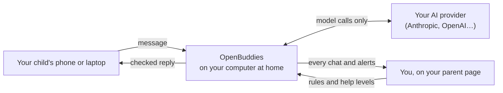
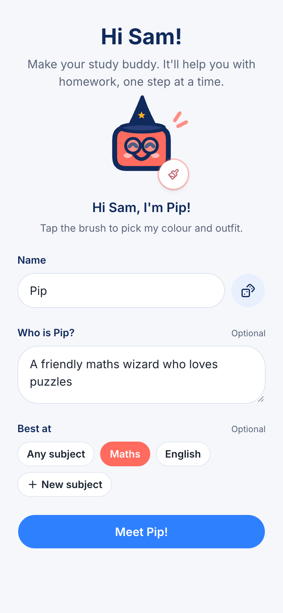
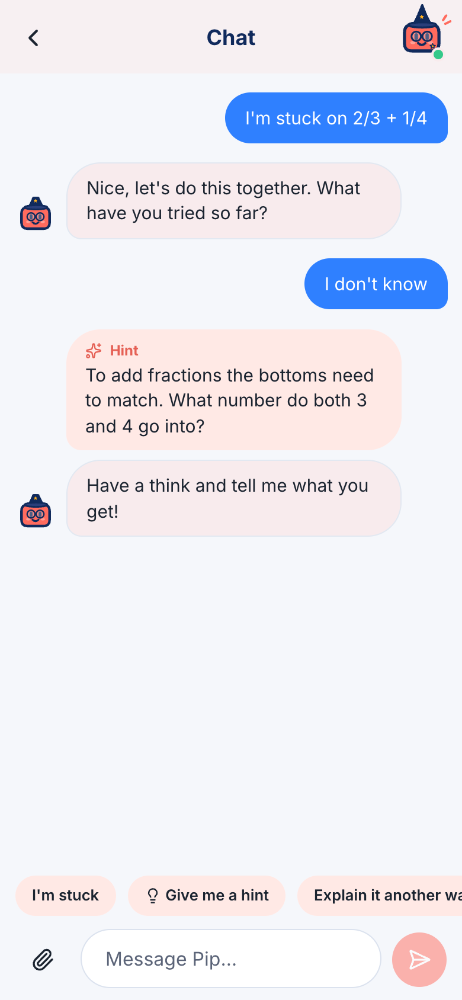
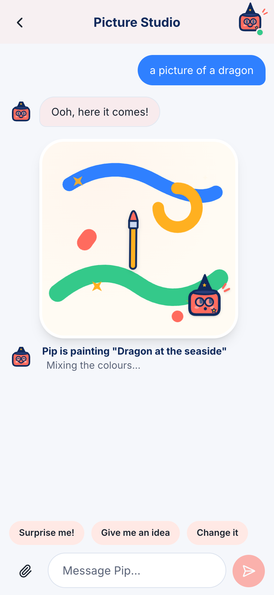
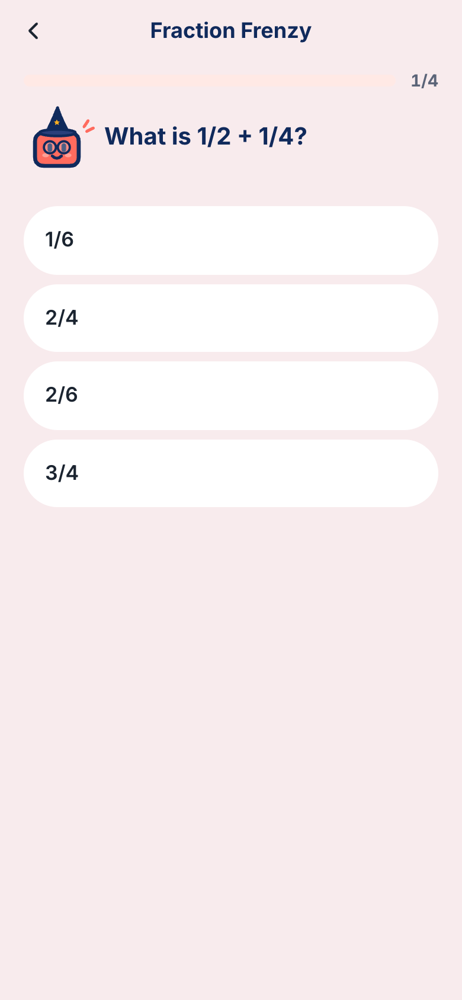
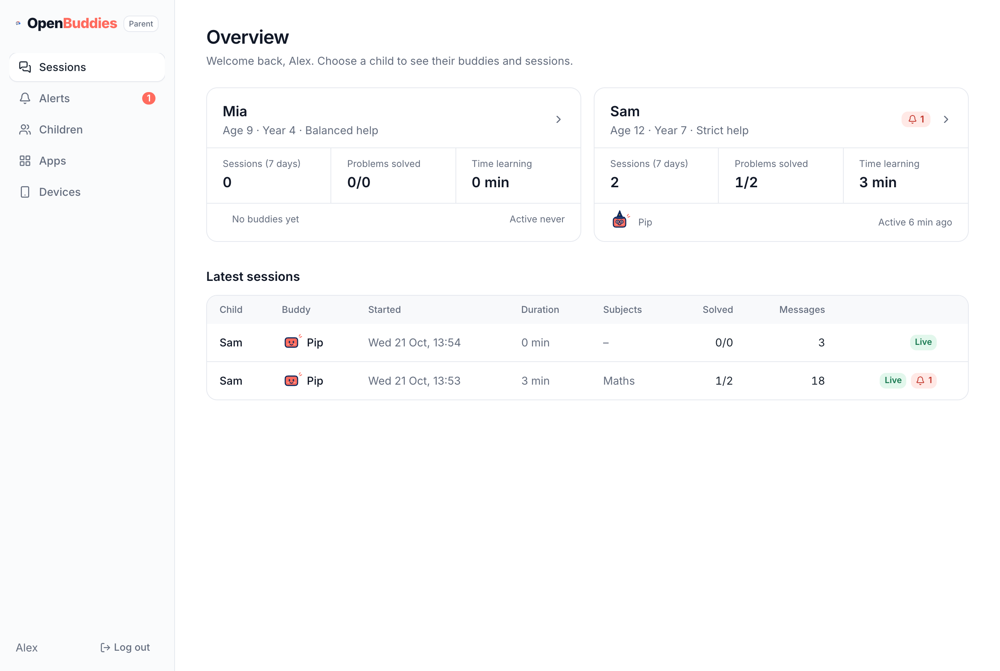
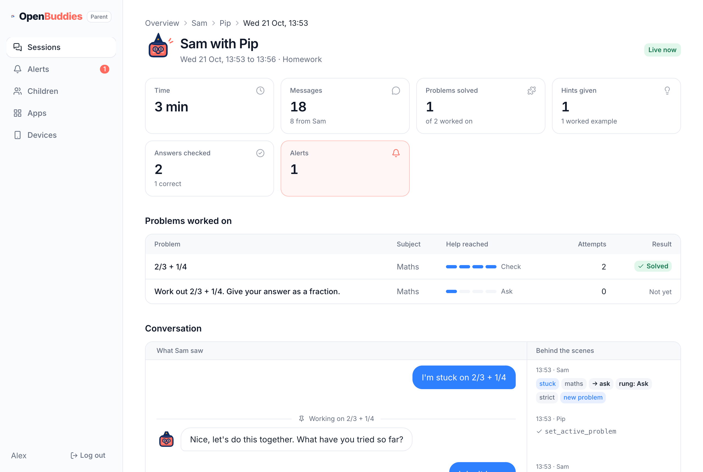

<p align="center">
  
</p>

<p align="center">
  <b>Open-source AI study buddies for families, self-hosted at home.</b><br>
  A pair tutor, not an answer machine.
</p>

## Features

- **Kids make their own buddies** to chat, draw pictures, take quizzes and get homework help, from their phone or laptop.
- **A tutor, not an answer machine.** Buddies guide with questions and hints, so children work things out themselves.
- **Parents stay in control.** Read every message, and set each child's help level, daily AI allowance and apps.
- **It all stays at home.** It runs on a computer in your house, the chats are kept there, and your API key never leaves
  it.

## How it works



You install OpenBuddies at home and connect your own AI provider. Your child pairs their device with a QR code. Every
message is checked before a reply reaches them, and you see it all on your parent page.

## Screenshots

<table>
  <tr>
    <td align="center" valign="top"><br><sub>Kids make their own buddy</sub></td>
    <td align="center" valign="top"><br><sub>Hints, not answers</sub></td>
    <td align="center" valign="top"><br><sub>Picture Studio</sub></td>
    <td align="center" valign="top"><br><sub>Quizzes on anything</sub></td>
  </tr>
</table>

<table>
  <tr>
    <td align="center" valign="top"><br><sub>Every child at a glance</sub></td>
    <td align="center" valign="top"><br><sub>Read every message, and why the buddy said it</sub></td>
  </tr>
</table>

## Get started

You'll need a computer that stays at home (macOS or Linux), Node.js 22 or newer, and an API key from your AI provider.

```
npm install -g openbuddies
openbuddies init      # set up your household (about 2 minutes)
openbuddies start     # your parent page opens; scan the QR code with your child's phone
```

## Learn more

- **[Docs](website/src/content/docs/docs/)**: the [setup tutorial](website/src/content/docs/docs/tutorials/set-up-your-household.mdx),
  guides for parents and kids, and how it all works. Run `cd website && pnpm install && pnpm dev` to read them locally.
- **[Technical reference](docs/technical-reference.md)**: commands, the security model and development.

## Licence

MIT. See [LICENSE](LICENSE).
