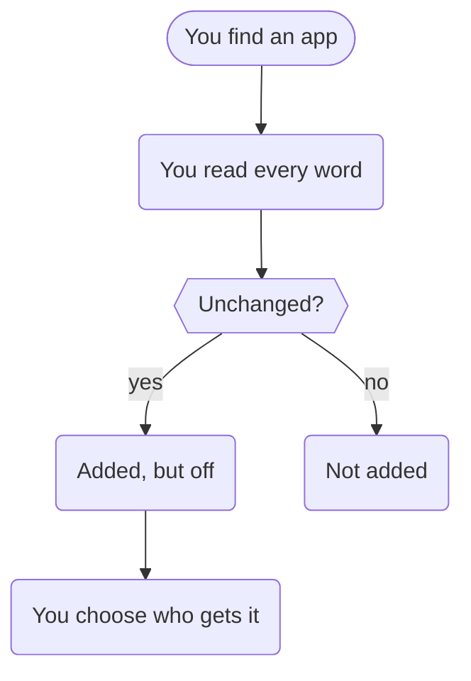

An OpenBuddies app is two text files: one says what it is, the other tells the buddy how to help. There's never any
code. That's what makes it safe to add an app that someone else wrote.

- **An app can't run anything** on your computer.
- **An app can't add tools.** It can only ask for features OpenBuddies already has, like reminders or pictures.
- **An app can't change the rules.** OpenBuddies' own instructions sit above the app's, and the checks in
  [How a message is handled](/docs/explanation/how-a-message-is-handled/) run whatever the app says. Homework answers
  stay hidden, worrying messages still alert you, and help levels and allowances still apply.
- **You read it first.** You see every word before adding it, and the copy installed is exactly the one you read
  (OpenBuddies checks its fingerprint).
- **It starts switched off.** Nobody gets a new app until you choose who does.

This also means anyone can write an app: a parent, a teacher, or a child with a good idea. See
[Write your first app](/docs/writing-apps/write-your-first-app/).
