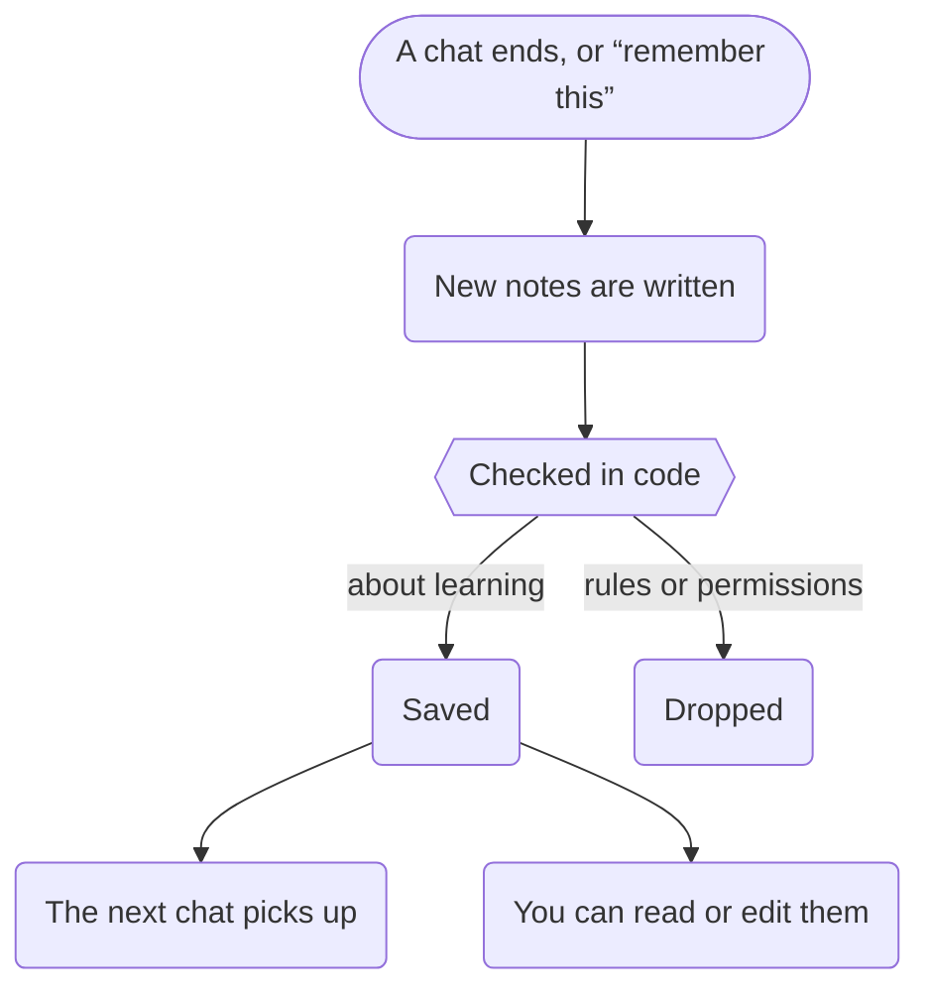

## A buddy is a personality, not a set of rules

When your child makes a buddy, they choose a name, a colour, a look and, optionally, what it's like ("a funny pirate")
and the subject it's best at. Each buddy keeps its own chats, files and memory. A child can make up to ten; the first is
their main buddy.

What your child writes about their buddy is treated as personality only. It changes how the buddy talks, never what
it's allowed to do: the safety checks never even read it.

## Files

Your child can keep homework photos and notes with each buddy, and share them in the chat with the paperclip or just by
mentioning them ("check our history homework"). A photographed question is read once when it's added, and that's what
the answer check guards, so a photo of the homework is protected like typed homework.

Photos are resized on the device before they're sent, which also removes hidden details such as where they were taken.

## Memory

Each buddy keeps short notes about what it's worked on with your child: topics, what they find tricky, what helps. So
the next chat picks up where the last one left off.

The notes are written after a sitting ends, or when your child asks the buddy to remember something. They never hold
personal details, feelings, family matters or anything about safety (worrying things go to you as alerts). That's
checked in code before the notes are saved: lines that try to give permission or change the rules are dropped.

You can read the notes, edit them or clear them on your parent page, and they're plain Markdown in the household
folder. Your child can see them on their buddy's page.
