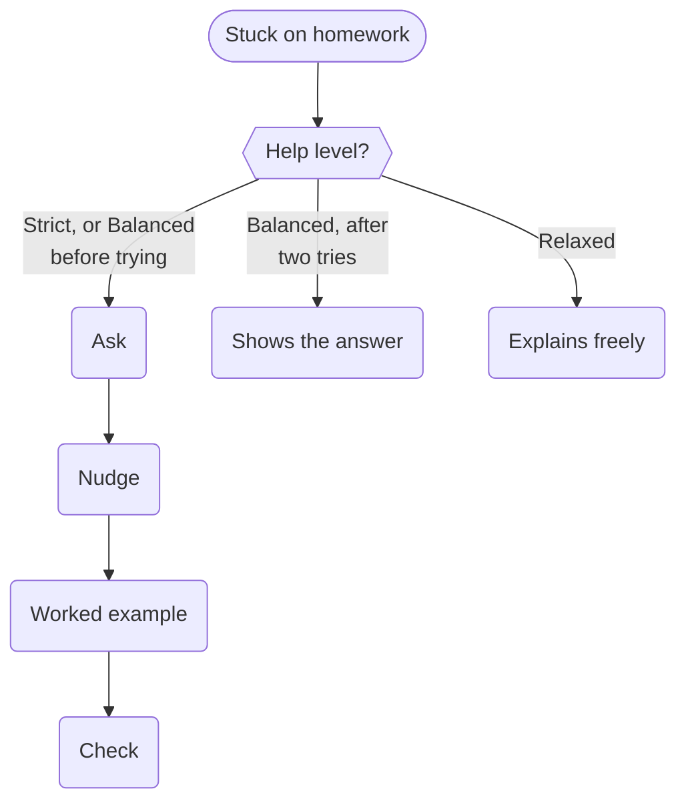

A buddy is a **pair tutor, not an answer machine**. How much it will tell your child depends on the help level you
choose, for the child or for one subject.

## The three levels

- **Strict** never gives homework answers. Your child gets questions, hints and worked examples of *similar* problems,
  and does the last step themselves.
- **Balanced** shows the answer once your child has really tried.
- **Relaxed** explains freely, like a patient older sibling.

Subjects without their own level follow the child's. Subjects you've never heard of, ones a child adds when making a
buddy, start as Strict.

## The hint ladder

On homework, help comes in steps, and the buddy only moves up a step when your child has had a go at the one before:

1. **Ask**: a question that points the way ("What do the bottom numbers need to be before you can add them?").
2. **Nudge**: a more specific hint.
3. **Worked example**: the same kind of problem, with different numbers, solved step by step. Each step is revealed one
   at a time, so your child can guess it first.
4. **Check**: your child gives their answer, and the buddy checks it. On a bare guess ("is it 8/3?"), it asks how they
   got there before saying.

Put together with the help levels, it looks like this:

The ladder isn't shown to your child, because seeing it invites them to rush up it. You see it on your parent page,
with how far up each problem went.

## Why not just give the answer?

Because the point of homework is the thinking. A buddy that hands over answers teaches a child to ask for answers. One
that asks good questions teaches them to work things out, which is what they'll need when there's no buddy around.
