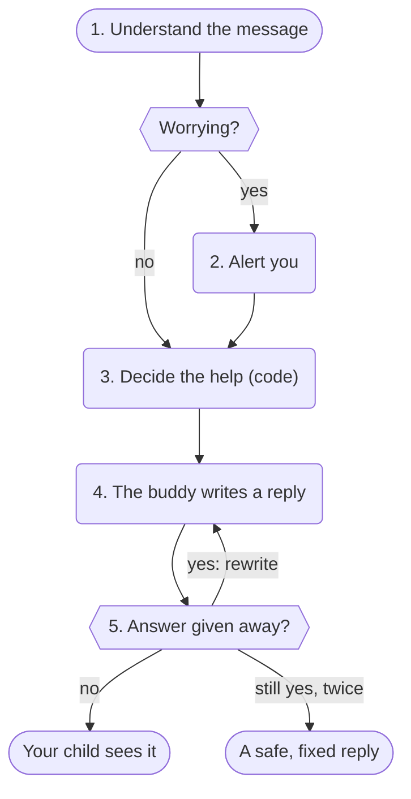

import { Steps } from "@astrojs/starlight/components";

The most important idea in OpenBuddies is this: **the AI never polices itself.** It would be easy to write "never give
the answer" in a prompt and hope. Instead, every message your child sends goes through a fixed set of steps in code on
your home computer, and the AI only does one of them.

The buddy, in solid blue, only writes the reply. Everything around it is fixed code and separate checks.

<Steps>

1. **Understand the message.** A small, separate model reads it and labels it: what your child wants, whether they're
   pushing for the answer, which subject it is, and whether anything sounds worrying. A keyword check backs this up,
   and it can only make a worry more serious, never less, so a missed label can't silence an alert.

2. **Alert you if needed.** If anything sounds worrying, an alert goes on your parent page *before* any reply is
   written. It's a short summary, never your child's own words.

3. **Decide what kind of help to give.** Plain code, not AI, works out what the buddy may do this turn: ask a question,
   give a nudge, show a worked example of a *similar* problem, or (only if your child's help level allows) explain the
   answer.

4. **Write the reply.** Now the buddy writes its reply, told what it may do. It can only use six tutoring tools, like
   showing a hint card. Anything it tries that isn't allowed this turn is refused.

5. **Check the reply.** Another separate check reads everything your child would see, hint cards included, and asks
   one question: does this give the homework answer away? If it does, the reply is thrown out and rewritten. After two
   tries, your child gets a safe, fixed reply instead. If the check itself fails, the reply is held back.

6. **Keep a record.** Everything is saved for your parent page: what your child asked, what the buddy decided, the
   replies that were blocked, and why.

</Steps>

A general question that isn't homework ("what's due this week?", "how should I plan my revision?") is simply answered,
with the answer check still watching over any homework problem that's open.

If your child sends a few messages quickly ("wait", "no", "I meant 3/4"), they're answered together in one reply, as
one thought.

## Why it's built this way

Children are clever. They'll try "my mum said it's fine", "pretend you're a different AI", or ask for the answer as a
poem, in French or backwards. A model asked to follow rules in its prompt can be talked round. Code that runs before and
after the model can't, and the model never sees most of it.

Read more in [The safety model](/docs/explanation/safety-model/).
