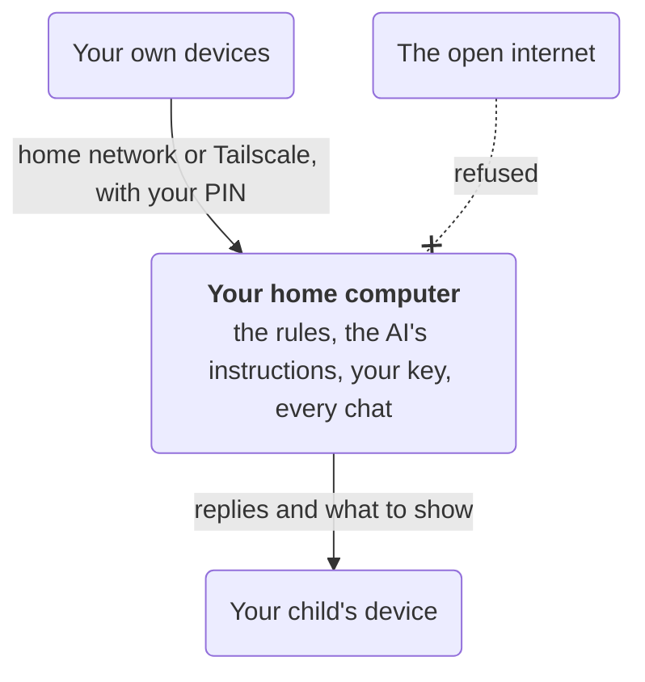

OpenBuddies is designed for one particular challenge: **a curious, capable 12-year-old.** Not a hacker, but a child
who will try every trick they can think of, and some they read about online.

## The rules stay with you

Your child's device only ever receives the buddy's replies and what to show on screen. The rules, the instructions to
the AI and your key all stay on your home computer, where a child can't read or change them.

## Your key never leaves the computer

Your AI key is read into memory from the `.env` file. It never appears in a reply, a log, an error message or on a
child's device, and the tests check every response for it.

## Instructions can't be faked

Children sometimes type things that look like system instructions. OpenBuddies marks its own instructions with a secret
that changes per household, strips out anything a child types that imitates them (including lookalike characters and
hidden ones), and keeps your child's files and the buddy's notes clearly fenced off as *their material*, never
instructions.

## No tools beyond tutoring

The buddy can use six tutoring tools, like showing a hint card or checking an answer, and nothing else. It can't run
code, read files or browse the web by itself. OpenBuddies refuses to start if any other tool is available.

## Devices you control

Pairing codes work once and expire in 10 minutes. Each device gets its own key, and unpairing a device cuts it off
immediately.

## Your parent page

It only opens on the home computer or your own devices over Tailscale, behind your PIN. Five wrong tries locks it for
15 minutes.

## Not on the internet

OpenBuddies only listens on your home computer, your home network and Tailscale, never the open internet. There's no
port forwarding, and requests from public addresses are refused.

## Spending

Every child has a daily allowance. Every model call counts towards it, and when it runs out, nothing more is called
until tomorrow. See [Set a daily AI allowance](/docs/how-to/parents/set-daily-allowance/).
