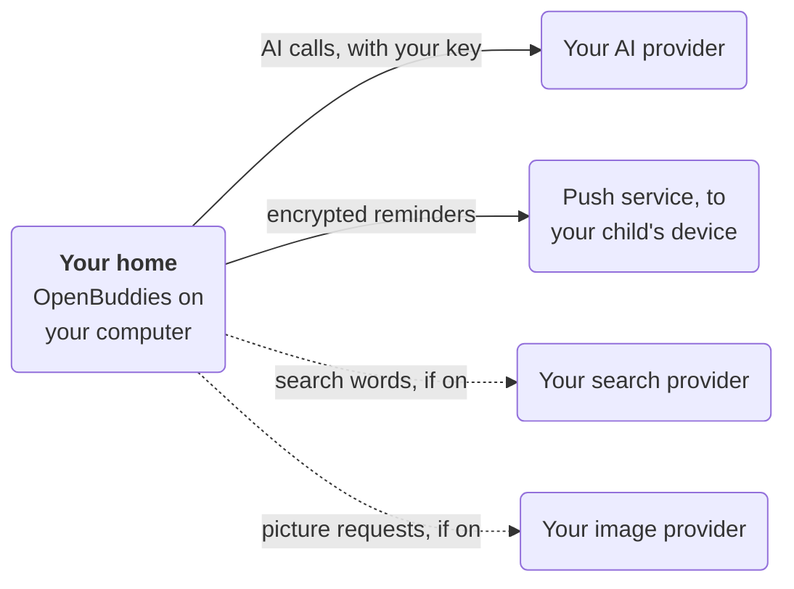

OpenBuddies runs on a computer in your home, not on our servers. There's no account to sign up for and nothing kept in
anyone else's cloud. We think that's the right way for a family to use AI with children:

- **Your children's chats are yours.** They're in one folder on your computer. Copy it and you've backed up everything.
- **You hold the key.** You use your own AI key, with your own spending limits.
- **You can see how it works.** It's open source, so you, or a friend who codes, can check exactly what it does.

## What leaves your home

Only these, and only to do their job:

The dashed ones only happen if you turn them on.

- **Calls to your AI provider** (Anthropic, OpenAI or the one you chose), with your key.
- **Reminder notifications** to your child's device, encrypted end to end, through the browser maker's push service.
- **Web searches**, if you turn them on: the search words, with your child's name and other details taken out, go to
  your search provider, and the chosen pages are read.
- **Image requests**, if you turn on Picture Studio, to your image provider.

Nothing else: no analytics, no tracking, no ads.
